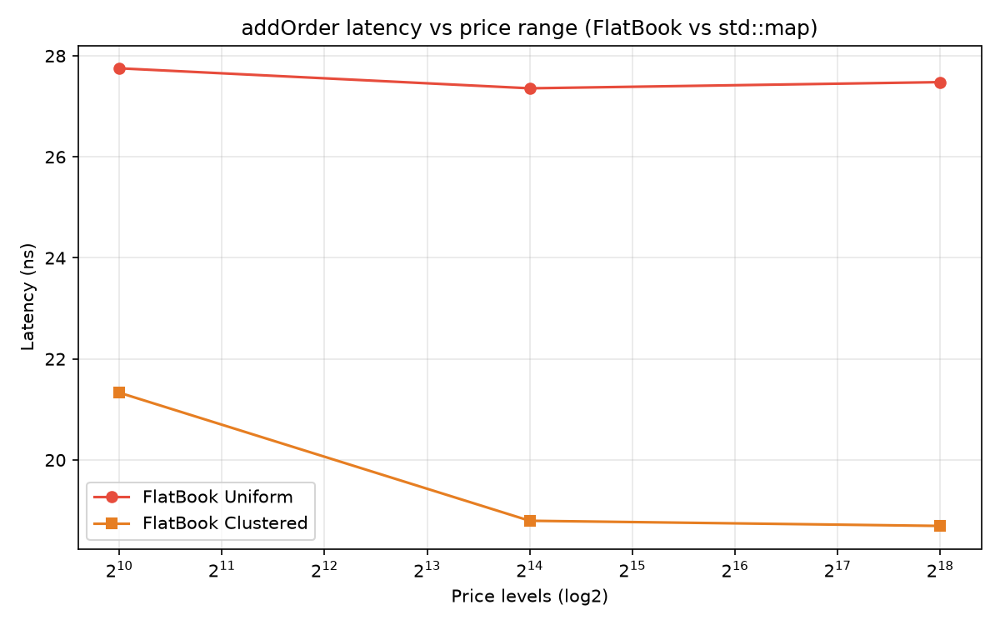
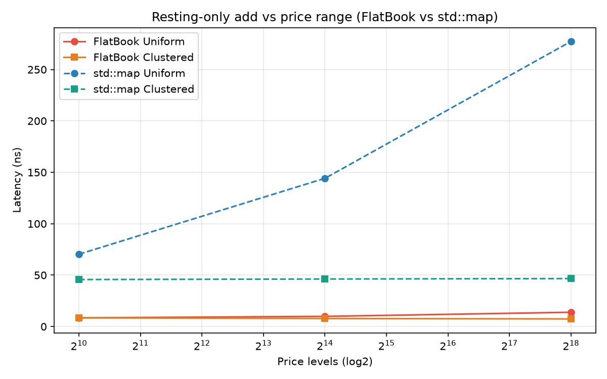
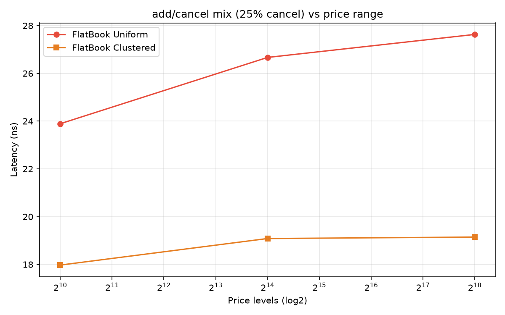
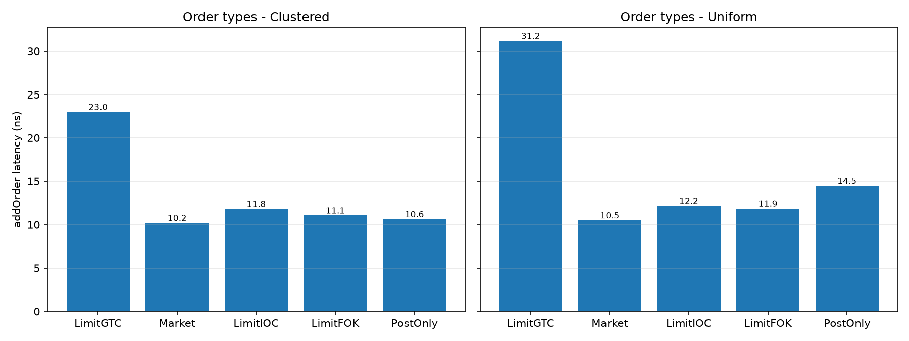
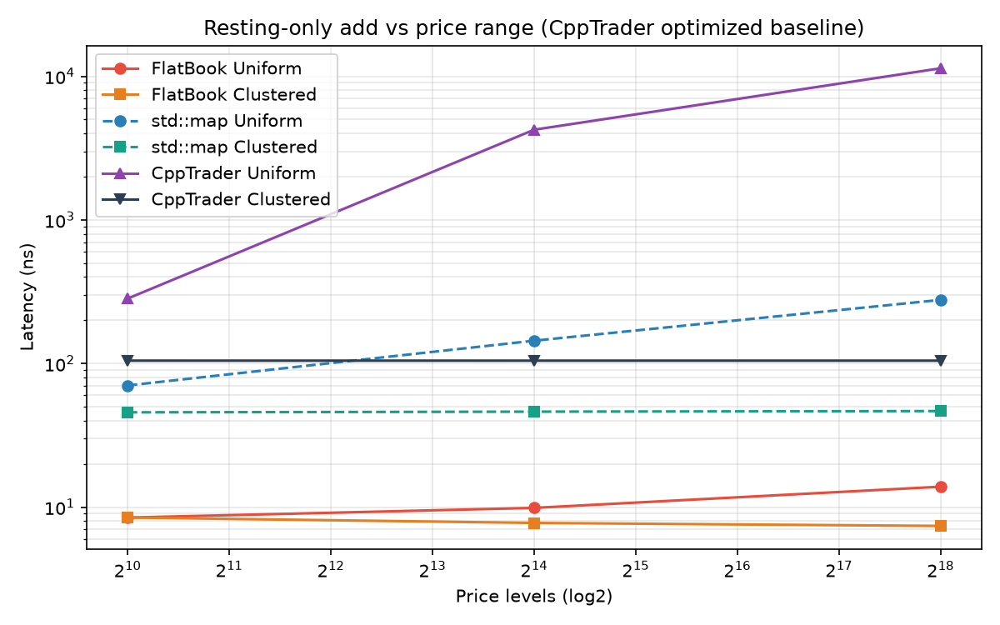

# Benchmarks

Measured with Google Benchmark, GCC 15, `-O3` (add `-DFLATBOOK_NATIVE=ON` for
`-march=native`), `CMAKE_BUILD_TYPE=Release`.

> **Reproducibility note:** the numbers below are single-run medians or
> medians-of-10, illustrative rather than a rigorous claim. They were measured
> on one machine; for anything you publish, record the CPU model, OS, and fixed
> CPU frequency (`performance` governor), and regenerate on a quiet machine —
> CI runners are noisy and have no stable frequency.

The benchmark sweeps three book configurations and two price-generation modes
(see `benchmarks/`):

- **Uniform** — prices drawn uniformly across the full configured tick range. An
  adversarial stress pattern that exposes how the structure behaves when the
  occupied range is wide.
- **Clustered** — a synthetic mid-price random-walks slowly, each order's price a
  small gaussian offset from it, approximating real microstructure.

## Add latency

| BookSize / PriceLevels | Uniform | Clustered |
|---|---|---|
| 32,768 / 1,024 | 27.0 ns | 20.2 ns |
| 131,072 / 16,384 | 27.2 ns | 18.9 ns |
| 524,288 / 262,144 | 27.7 ns | 19.2 ns |

**Why it scales.** Best-bid/best-ask discovery is O(1) via the multi-level
bitmap, and insert/remove are O(1), so latency is flat across the full 256x
price range (27.0 → 27.7 ns uniform). The configured `levels_` array grows with
`PriceLevels`, but the working set touched per operation stays small.

## std::map baseline

A `std::map`-based book (`BM_MapLatency`, same workload, with an `unordered_map`
id→level index so its cancel is not a whole-book scan) shows the contrast on the
uniform pattern:

| Price levels | FlatBook | std::map |
|---|---|---|
| 1,024 | 27.0 ns | 73.3 ns |
| 16,384 | 27.2 ns | 91.2 ns |
| 262,144 | 27.7 ns | 109.2 ns |

The map grows with the price range (every level lookup chases a tree node, every
insert allocates); FlatBook stays flat because its price discovery is a constant
number of bitmap levels and it allocates nothing.

The add-only, 50/50 crossing mix above is the *best case* for `std::map` — half
the orders match and never insert. The per-workload picture (uniform, 1,024
levels):

| Workload | FlatBook | std::map | ratio |
|---|---|---|---|
| add, mixed crossing (`BM_Latency`/`BM_MapLatency`) | 27.0 ns | 73.3 ns | 2.7× |
| add, resting-only (`BM_RestLatency`/`BM_MapRestLatency`) | 7.7 ns | 72.4 ns | 9.4× |
| add/cancel mix, 25% cancel (`BM_Cancel`/`BM_MapCancel`) | 25.7 ns | 73.0 ns | 2.8× |

The resting gap widens with `PriceLevels` (7.7 → 12.3 ns FlatBook vs 72 → 278 ns
map at 262,144 levels): every rest in a map is a tree-node `new`, FlatBook
writes one flat-array slot. The map's cancel is an O(1) index lookup plus an
O(k) scan of the level queue plus an erase; FlatBook cancels by id in O(1).

## CppTrader baseline

FlatBook is also measured against [CppTrader](https://github.com/chronoxor/CppTrader)'s
optimized market manager — the same flat-array + sorted-price-level technique,
vendored under its MIT license in `benchmarks/src/reference/cpptrader/`. It is a
market-data replay container (it maintains levels but does not match), so the
comparison is on the resting-only path only. Median of 10 runs:

| Price levels | FlatBook | std::map | CppTrader |
|---|---|---|---|
| 1,024 | 8.5 ns | 69.9 ns | 283.4 ns |
| 16,384 | 9.6 ns | 131.1 ns | 4,244 ns |
| 262,144 | 13.4 ns | 270.5 ns | 11,359 ns |

CppTrader stores price levels in a `std::vector` sorted by price and finds a
level by scanning linearly back from the best price, and inserting a *new* level
shifts every element after it (a memmove). A far-away level therefore pays two
O(levels) penalties — a scan plus a shift — where FlatBook pays neither: price
*is* the array index (O(1) insert), and the hierarchical bitmap finds the best
price in O(1). Near the touch (clustered) the scan is short and the insert lands
at the end (~105 ns, flat); on wide-range uniform flow both penalties bite, and
it degrades from 283 ns to 11.4 µs.

## Tail latency

Means and medians hide the worst case, so `./dev.sh tail` measures per-operation
latency percentiles (TSC-based, 100k samples per row, FlatBook `BookSize`
262,144):

| Workload | p50 | p99.9 |
|---|---|---|
| FlatBook add (mixed crossing) | 10-20 ns | 70-130 ns |
| FlatBook rest | ~10 ns | 20-40 ns |
| std::map rest | 40-210 ns | 120 ns - 2 µs |
| CppTrader rest (uniform) | 0.4-13 µs | 0.9-35 µs |

FlatBook's tail stays in tens-to-hundreds of nanoseconds; the reference
containers blow into microseconds on wide price ranges. The `max` column (not
shown) is a rare 1-in-100k scheduler/cache outlier, not the book itself — clean
tails need core pinning and fixed CPU frequency, so treat these as indicative,
like the averages above. Note that the TSC timer overhead (tens of cycles) is
comparable to the ~10 ns p50, so the smallest numbers are near the measurement
floor.

## Running the benchmarks

```bash
cmake -S . -B build -DCMAKE_BUILD_TYPE=Release -DFLATBOOK_NATIVE=ON
cmake --build build -j
./build/benchmarks/flatbook_bench                       # everything
./build/benchmarks/flatbook_bench --benchmark_filter=BM_Latency
./build/benchmarks/flatbook_bench --benchmark_filter=BM_OrderType
```

The order-type sweep measures `addOrder` per type (`LimitGTC`, `Market`,
`LimitIOC`, `LimitFOK`, `PostOnly`). Note: on random flow, FOK orders are mostly
rejected immediately, so its number reflects the cheap reject path, not a
deep-book full fill.

The dispatcher throughput benchmark is `flatbook_dispatcher_bench`: end-to-end
~18M orders/s with one worker (mixed crossing, 256 symbols) and near-linear
scaling with the worker count (~2.2× at 2, ~4.3× at 4, saturating near the core
count at 8). The single ingress and collector threads bound how far it scales.

## Graphs

Each chart plots latency vs the configured price range (`std::map` dashed,
FlatBook solid), for both uniform (adversarial wide-range) and clustered
(near-touch) patterns.

**1. Add (mixed 50/50 crossing).** `std::map`'s best case: half the orders match
and never insert, so its O(log n) insert is amortized away.



FlatBook is flat (~27 ns) across the full 256× range; `std::map` grows 73 → 109 ns.

**2. Resting-only (every order rests).** Pure allocation: every rest is a
tree-node `new` in `std::map`, one flat-array write in FlatBook.



FlatBook ~8-13 ns; `std::map` grows 72 → 278 ns (9-22×).

**3. Add/cancel mix (25% cancel).**



FlatBook ~26 ns vs `std::map` ~73 ns at 1,024 levels.

**4. Per order type (FlatBook).** FOK on random flow mostly measures the cheap
reject path.



**5. CppTrader optimized baseline (resting-only, log scale).** The CppTrader
line explodes on uniform — its sorted-vector levels pay an O(levels) scan plus
shift per far-away insert — while FlatBook stays flat.



One command to build, run and re-plot (requires `matplotlib`):

```bash
PYTHON=/path/to/python-with-matplotlib ./dev.sh bench
```

Or manually:

```bash
./build/benchmarks/flatbook_bench \
    --benchmark_filter="BM_Latency|BM_MapLatency|BM_RestLatency|BM_MapRestLatency|BM_CppTraderRestLatency|BM_Cancel|BM_MapCancel|BM_OrderType" \
    --benchmark_min_time=0.2s --benchmark_repetitions=10 --benchmark_report_aggregates_only=true \
    --benchmark_format=json --benchmark_out=/tmp/bench.json

python3 benchmarks/plot/plot_scaling.py /tmp/bench.json docs
```

Writes `docs/add_vs_price_levels.png`, `docs/rest_vs_price_levels.png`,
`docs/cancel_vs_price_levels.png`, `docs/cpptrader_vs_price_levels.png` and
`docs/order_type.png`.
